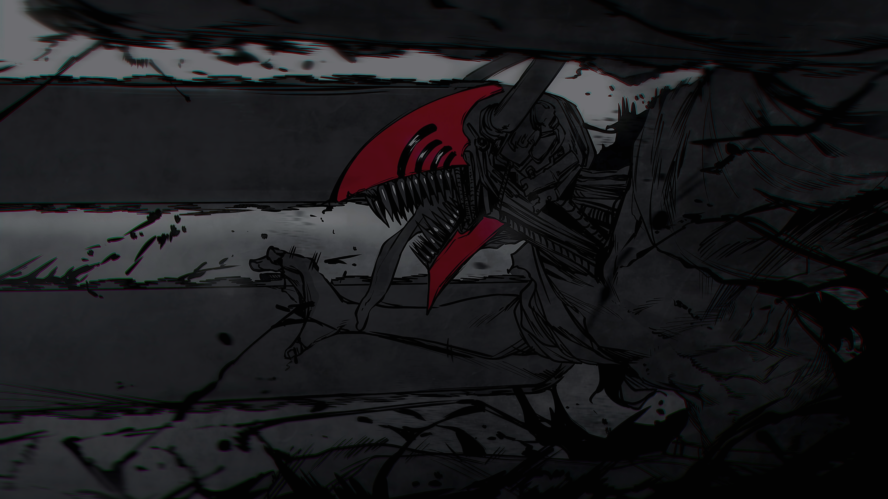

# Neovim + OpenCode workstation replica

A reviewed snapshot of Maximoff19's Neovim, OpenCode, and optional terminal
configuration, with an agent skill and an offline Python restore tool.

## Download on another computer

Requires Python 3.9+ and an archive extractor. This command only downloads files:

```bash
curl --fail --location --proto '=https' --tlsv1.2 \
  https://github.com/Maximoff19/workstation-replica/releases/latest/download/workstation-replica.zip \
  --output workstation-replica.zip
```

Optionally download `SHA256SUMS` from the same release and verify the ZIP using
your platform's SHA-256 tool. Checksums detect corruption, not a compromised
publisher or release.

Extract into a new working directory, review `SKILL.md`, `replica.py`, the
manifest, configuration, and plugin code. Do not pipe a remote script into a shell.

```bash
unzip workstation-replica.zip -d workstation-replica-files
python3 workstation-replica-files/replica.py restore --bundle workstation-replica.zip --terminal
```

The command above is a **dry run**. To apply the reviewed plan after closing the
affected applications:

```bash
python3 workstation-replica-files/replica.py restore --bundle workstation-replica.zip --terminal --apply
python3 workstation-replica-files/replica.py verify --bundle workstation-replica.zip --terminal
```

`--terminal` includes Ghostty, tmux, and Zellij. Omit it from both commands to
restore only Neovim/OpenCode/skills. Applying replaces selected configuration
roots and backs up the previous roots; read the printed backup path.

**For another AI agent:** read `SKILL.md` inside the ZIP, inspect the dry run,
preserve backups, and follow `references/runtime-setup.md`. Do not execute copied
plugins or MCPs until their code and broad permission settings have been reviewed.

## Included configuration

| Component | Snapshot |
|---|---|
| Neovim | LazyVim, keymaps, plugin specifications, spelling data, plugin lockfile; `gentleman-kanagawa-blur` |
| OpenCode | Agents, commands, instructions, profiles, plugins, MCP definitions, `gentleman` theme |
| Skills | All four global source directories; 232 SKILL.md definitions, 122 distinct names |
| Ghostty | `Citruszest`, shaders, keybindings, opacity/blur, `IosevkaTerm NF` font settings |
| Terminal extras | tmux and Zellij settings, restored only with `--terminal` |

The complete reviewed payload is browsable under `snapshot/payload/`; its
manifest records file hashes, source executable versions, and intentional
omissions. The release ZIP preserves that payload's original layout.

## Desktop wallpaper


The 3840 × 2160 image used as the wallpaper on both source displays is available
as [assets/wallpaper.jpg](assets/wallpaper.jpg). Download it separately:

```bash
curl --fail --location --proto '=https' --tlsv1.2 \
  https://raw.githubusercontent.com/Maximoff19/workstation-replica/main/assets/wallpaper.jpg \
  --output wallpaper.jpg
```

Set it through the destination operating system's wallpaper settings. The v1.0.0
configuration ZIP is unchanged and does not install or change the wallpaper.
The artwork belongs to its respective rights holders; no ownership is claimed.

## Additional wallpaper: Chainsaw Man



This additional **3840 × 2160 PNG** matches the dark image supplied for the
repository. It is available separately and does not replace the original
wallpaper asset or change the currently active desktop wallpaper.

Download it on the other computer:

```bash
curl --fail --location --proto '=https' --tlsv1.2 \
  https://raw.githubusercontent.com/Maximoff19/workstation-replica/main/assets/wallpaper-chainsaw-man.png \
  --output wallpaper-chainsaw-man.png
```

Then select the downloaded image in the operating system's wallpaper settings.
On macOS, open **System Settings → Wallpaper** and add the downloaded image.
The compressed image data and color information are preserved; textual, EXIF,
and timestamp metadata are excluded from the publication copy when present.
The artwork belongs to its respective rights holders. The v1.0.0 configuration
ZIP is unchanged; this image is a separate download.

## Terminal prompt symbol

The prompt uses the Nerd Font symbol **`󰭟` (U+F0B5F)** through Starship, rather
than an image file. The exact [Starship configuration](terminal/starship.toml)
and [symbol text](assets/prompt-symbol.txt) are included in the repository.
See [terminal setup](terminal/README.md) for the download and Fish initialization
instructions. Use **IosevkaTerm NF** in Ghostty to match the source font.

These files are separate additions; the v1.0.0 configuration ZIP is unchanged.

## What is intentionally not copied

- Authentication stores, OAuth sessions, chat history, memory databases, mobile
  pairing tokens, old configuration backups, and dependency caches.
- Recognized inline credential values. The captured MCP key is replaced with an
  environment reference; reconnect accounts and configure credentials privately.
- Fonts, application binaries, external repositories/vaults, and OS services.
  Install the same Nerd Font separately. Figma's local MCP needs Figma Desktop.

Some remote services and packages use `latest` or ranges. Files can be reproduced,
but an identical runtime or appearance on different OS/hardware is not guaranteed.
Native Windows requires adaptation; macOS or Linux/WSL is the intended environment.

This particular snapshot was intentionally published with its owner's permission.
That is **not** permission to publish future exports without another privacy and
secret review. Automated scanning is best-effort and cannot prove absence of all
sensitive information. Paths, prompts, server URLs, and permission rules are public
in this reviewed snapshot.

## Development

```bash
PYTHONDONTWRITEBYTECODE=1 python3 -m unittest discover -s scripts -v
REPLICA_TEST_BUNDLE="$PWD/dist/workstation-replica.zip" \
  PYTHONDONTWRITEBYTECODE=1 python3 -m unittest discover -s scripts -v
```

The tests use temporary homes, not the developer's live configuration. No package
manager or copied plugin runs during an offline restore.

Third-party skills and configuration retain their original notices and terms.
This repository does not relicense third-party material.
